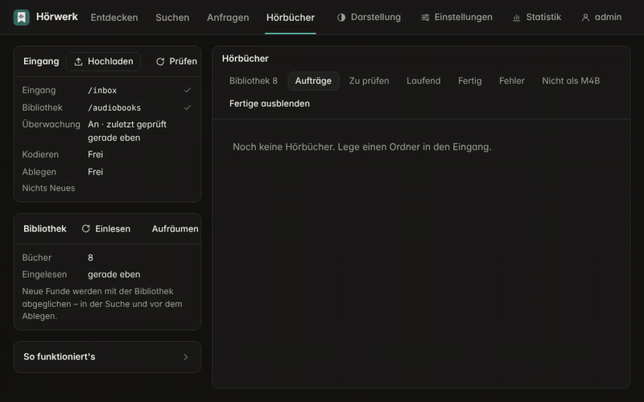
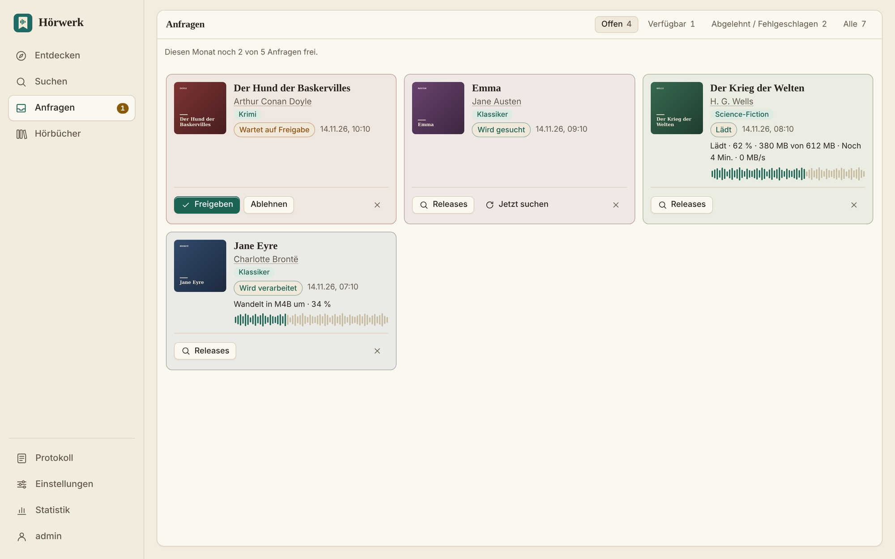
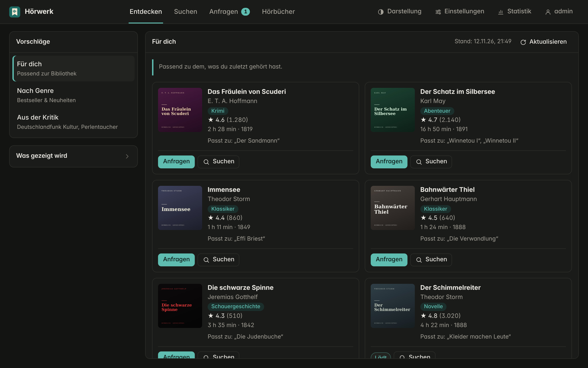
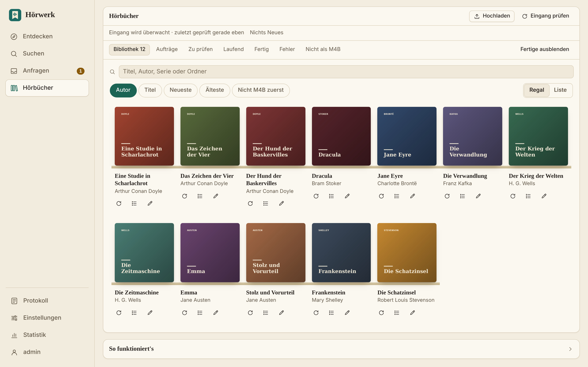

# Hörwerk

**Vom CD-Rip zum fertigen Hörbuch in Audiobookshelf oder Plex – in einem Durchgang, mit sauberen Metadaten und zuverlässiger Verarbeitung deutscher Umlaute.**

[](https://github.com/Larosen/hoerwerk/actions/workflows/docker.yml)
[](CHANGELOG.md)
[](LICENSE)

[English](README.md) · **Deutsch**



## Warum Hörwerk?

Meine Hörbuchsammlung war unübersichtlich. CD-Rips lagen in `CD1`/`CD2`/`CD3`-Unterordnern, MP3s hießen `Track 01`,
`Track 02`, und die Metadaten fehlten oder waren unvollständig. Cover, Titel, Autor und Beschreibung waren in Plex und
Audiobookshelf falsch oder gar nicht vorhanden.

Über die Jahre habe ich aus mehreren Werkzeugen einen Workflow zusammengestellt, der für einheitliche Metadaten, eine
saubere Ordnerstruktur und korrekte Kapitelnamen sorgen sollte. Da meine Familie viele Hörbücher hört, wurde das
aufwendig: Mit einem Werkzeug zusammenfügen, mit einem anderen taggen und Metadaten manuell recherchieren kostete pro
Buch einen ganzen Abend. Hinzu kommt, dass viele Werkzeuge deutsche Hörbücher unzureichend verarbeiten, weil Umlaute und
Autorennamen mit Sonderzeichen zu Fehlern führen.

Hörwerk richtet sich an alle, die ihre eigene Hörbuchsammlung auf einem NAS oder Server betreiben und diesen Ablauf
automatisieren möchten.

## Was es kann

- **Eingang → Bibliothek, vollautomatisch.** Ordner ablegen (MP3, M4A, FLAC, `CD1`/`CD2` …) und **eine M4B mit
  Kapiteln** bekommen, abgelegt als `Autor/Serie/03 - Titel`, mit Cover, Sprecher, Serie und Beschreibung von Audible.
- **Deutsche Titel und Namen, richtig behandelt.** Umlaute und Sonderzeichen in Titeln und Autorennamen werden in jeder
  Schreibweise erkannt (`ä`, `ae`, `a` …), damit deutsche Hörbücher zuverlässig zugeordnet werden.
- **Anfragen für die ganze Familie.** Familienkonten entdecken Bücher und fragen sie an; du gibst frei, Hörwerk besorgt
  sie und zeigt den Fortschritt von Download und Umwandlung. Einem Autor oder Sprecher **folgen**, und jedes neue Buch
  wird von selbst angefragt – oder aus allen seinen Büchern auf einmal auswählen.
- **Eine Suche, die Hörbücher versteht.** Jedes Release wird vor dem Laden beurteilt: richtiges Buch, richtige
  Sprache, ungekürzt und die *richtige Aufnahme* – nicht die Lesung, wenn das Hörspiel gefragt war.
- **Freie Hörbücher eingebaut.** LibriVox (gemeinfrei) auf Deutsch und Englisch, mit einem Klick in den Eingang.
- **Eine aufgeräumte Bibliothek.** Erkennt Doppelte, wandelt alte MP3-Bücher um, räumt Kapitelnamen auf, sucht für
  ein vorhandenes Buch ein besseres Release – und löscht die alte Fassung nie ohne geprüfte neue.
- **Empfehlungen.** *Entdecken* lernt aus dem Hörverlauf jedes Nutzers in Audiobookshelf oder Plex und schlägt dazu
  passende Bücher vor; dazu kommen Tipps von Kritikern (Perlentaucher, Deutschlandfunk Kultur).
- **Klein und abgesichert.** Ein Rust-Programm, eigenes schlankes ffmpeg in einer Sandbox, Zweitfaktor, signierte Images.

| Anfragen mit Fortschritt | Entdecken |
|---|---|
|  |  |



## Schnellstart

**Unraid:** *Docker → Add Container*, als Template
`https://raw.githubusercontent.com/Larosen/hoerwerk/main/unraid/hoerwerk.xml`, Eingang und Bibliothek eintragen,
`http://<unraid-ip>:8080` öffnen und das Admin-Konto anlegen.

**docker compose:**

```bash
curl -O https://raw.githubusercontent.com/Larosen/hoerwerk/main/docker-compose.yml
# die beiden Ordnerpfade und PUID/PGID (siehe `id`) eintragen, dann:
docker compose up -d
```

Image: `ghcr.io/larosen/hoerwerk:latest` (oder eine feste Version wie `:7.20.0`) – amd64, jede Woche für
Sicherheitsupdates neu gebaut, mit cosign signiert.

## Was es nicht ist

- **Kein Player.** Hörwerk füllt die Bibliothek; gehört wird mit Audiobookshelf, Plex oder jeder App, die M4B spielt.
- **Keine Quelle für Bücher.** Es arbeitet mit *deinen* Dateien, *deinem* SABnzbd und *deinen* Indexern. Die einzige
  eingebaute Quelle ist LibriVox. Es entfernt keinen Kopierschutz.
- **Nur amd64** bisher; arm64 steht auf der [Roadmap](docs/ROADMAP.md).

## Dokumentation

| | |
|---|---|
| [Hörbücher](docs/de/guide.md) | Eingang, Hochladen, Zuordnung, Doppelte, Kapitel, Fassungen, Audiobookshelf und Plex |
| [Downloads, Entdecken, Anfragen](docs/de/downloads.md) | SABnzbd und Indexer, LibriVox, Vorschläge, Anfragen der Familie |
| [Konfiguration](docs/de/configuration.md) | Konten, Zugriff von außen, Benachrichtigungen, Variablen, Backup |
| [Sicherheit](SECURITY.de.md) | wovor Hörwerk schützt und wie das getestet wird |
| [Changelog](CHANGELOG.md) · [Roadmap](docs/ROADMAP.md) · [Entwicklung](docs/de/development.md) | |

> Hörwerk verwaltet Audiodateien, die du nutzen darfst – eigene Käufe, eigene Aufnahmen oder gemeinfreie Werke.
> Es enthält keine Medien und steht in keiner Verbindung zu Audible, Amazon, Apple, LibriVox oder anderen genannten
> Diensten. Die Bücher in den Screenshots sind gemeinfreie Klassiker mit ausgedachten Covern.

## Entstehung

Hörwerk wurde mit Claude Opus 5.5 und Claude Fable 5.2 entwickelt. Das Ziel war ein Werkzeug, das den gesamten Prozess
automatisiert, deutsche Hörbücher zuverlässig verarbeitet und möglichst viel manuelle Arbeit erspart.

## Mitmachen

Du hast einen Fehler gefunden, vermisst eine Funktion oder kennst weitere gute Quellen für Hörbuch-Empfehlungen?
Bitte eröffne ein [Issue](https://github.com/Larosen/hoerwerk/issues). Hinweise sind willkommen, passende Quellen
werden nach Möglichkeit eingebunden.

## Lizenz

Hörwerk steht unter der [PolyForm Noncommercial License 1.0.0](LICENSE): kostenlos für private und andere
nichtkommerzielle Nutzung – für die eigene Bibliothek, die Familie, ein Hobbyprojekt, Forschung oder gemeinnützige
Zwecke. Du darfst es unter denselben Bedingungen weitergeben und ändern. Kommerzielle Nutzung ist nicht abgedeckt;
wenn du sie planst, melde dich bitte über ein Issue. Hörwerk ist damit *source-available*, aber kein Open Source im
Sinne der OSI.

Das Docker-Image enthält außerdem FFmpeg, aus dem offiziellen Quelltext ohne GPL-Teile gebaut und damit unter der
[LGPL 2.1](https://www.ffmpeg.org/legal.html); das Bauskript ist [docker/build-ffmpeg.sh](docker/build-ffmpeg.sh).
Die Lizenzen aller Rust-Bibliotheken stehen in [THIRD-PARTY-LICENSES.md](THIRD-PARTY-LICENSES.md).

Inspiriert von [auto-m4b](https://github.com/seanap/auto-m4b) und [beets-audible](https://github.com/Neurrone/beets-audible);
Kapiteldaten über [Audnexus](https://github.com/laxamentumtech/audnexus).
