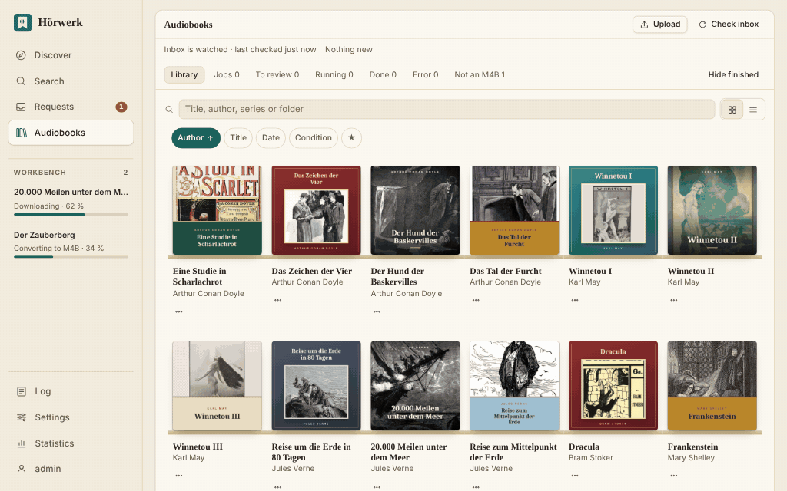
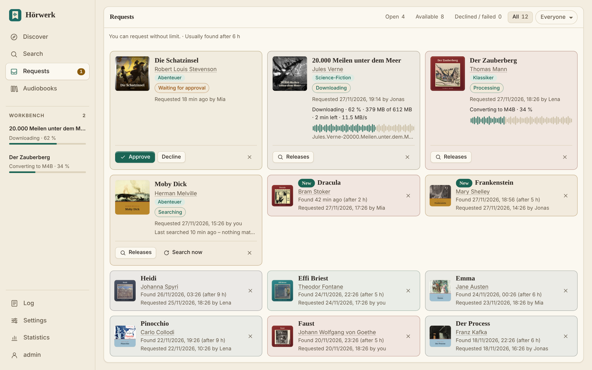
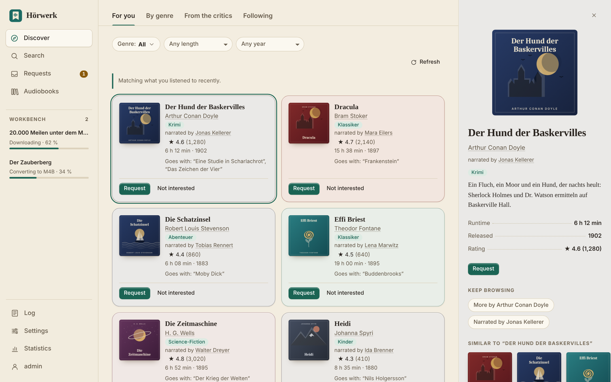
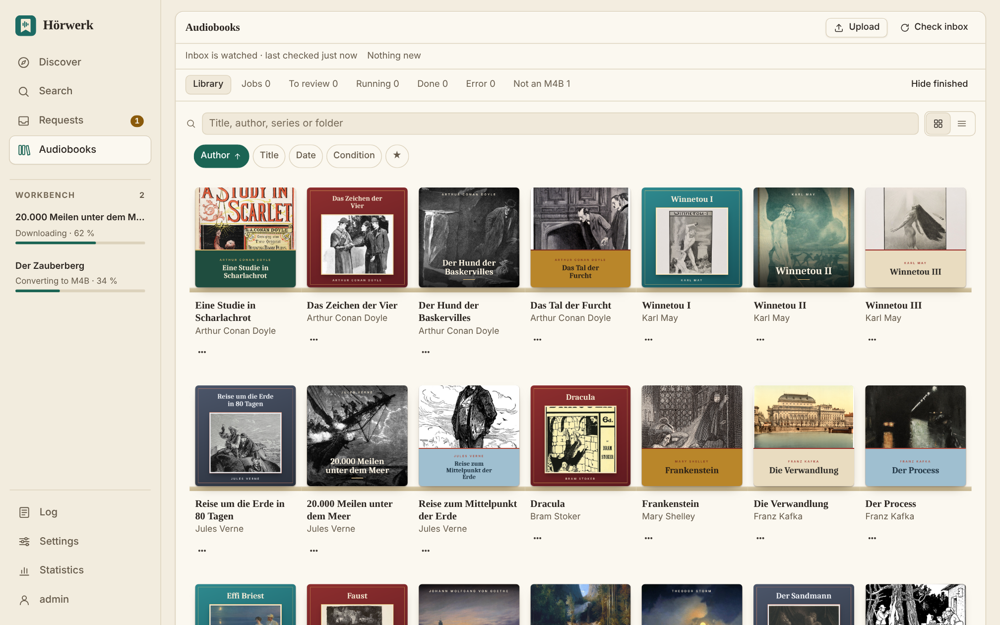

# Hörwerk

**Hörwerk makes a CD rip into a finished audiobook for Audiobookshelf or Plex. It does this in one step, with correct metadata and correct German umlauts.**

[](https://github.com/Larosen/hoerwerk/actions/workflows/docker.yml)
[](CHANGELOG.md)
[](LICENSE)

**English** · [Deutsch](README.de.md)



## Why Hörwerk?

My audiobook collection was not in order. CD rips were in `CD1`/`CD2`/`CD3` subfolders. MP3 files had names like
`Track 01` and `Track 02`. Plex and Audiobookshelf showed wrong or missing covers, titles, authors and descriptions.

I used many tools to get correct metadata, folders and chapter names. My family listens to many audiobooks, so this
took much time: one book took one evening. Many tools also make errors with German umlauts and special characters.

Hörwerk is for self-hosters who keep audiobooks on a NAS or server. It does all these steps automatically.

## What it does

- **Inbox to library, automatically.** Put a folder in the inbox (MP3, M4A, FLAC, `CD1`/`CD2` …). You get **one M4B
  with chapters** in `Author/Series/03 - Title`. Cover, narrator, series and description come from Audible.
- **Correct German titles and names.** Hörwerk finds umlauts and special characters in all spellings (`ä`, `ae`,
  `a` …). Thus it finds German audiobooks reliably.
- **Requests for the family.** Family accounts find and request books. You approve. Hörwerk gets the book and shows
  the progress. **Follow** an author or narrator, and Hörwerk requests each new book automatically.
- **A search for audiobooks.** Hörwerk checks each release before the download: correct book, correct language,
  unabridged and the *correct recording* (for example, the full cast and not one narrator).
- **Free audiobooks.** LibriVox (public domain) in English and German. One click puts a book in the inbox.
- **A clean library.** Hörwerk finds duplicates, converts old MP3 books and corrects chapter names. It finds better
  releases of your books. It deletes an old copy only after it has checked the new copy.
- **Recommendations.** *Discover* uses the listening history of each user in Audiobookshelf or Plex. It also shows tips
  from critics (Perlentaucher, Deutschlandfunk Kultur). Tap a book to see its description and *Similar to …*.
- **Three colour schemes and a home-screen app.** Light, dark and OLED (black). On iPhone and iPad, Hörwerk runs full
  screen like an app ([how to](docs/iphone-app.md)).
- **Small and safe.** One Rust program, its own small ffmpeg in a sandbox, two-factor login and signed images.

| Requests with live progress | Discover |
|---|---|
|  |  |



## Quick start

**Unraid:**

1. Go to *Docker → Add Container*.
2. Use the template `https://raw.githubusercontent.com/Larosen/hoerwerk/main/unraid/hoerwerk.xml`.
3. Set the inbox folder and the library folder.
4. Open `http://<unraid-ip>:8080` and make the admin account.

**docker compose:**

```bash
curl -O https://raw.githubusercontent.com/Larosen/hoerwerk/main/docker-compose.yml
# set the two folder paths and PUID/PGID (see `id`). Then:
docker compose up -d
```

Image: `ghcr.io/larosen/hoerwerk:latest` or a fixed version, for example `:1.0.0`. It is for amd64 and arm64.
We build it again each week for security updates. Cosign signs it.

## What it is not

- **No player.** Hörwerk fills the library. Listen with Audiobookshelf, Plex or an app that plays M4B.
- **No source of books.** It uses *your* files, *your* SABnzbd and *your* indexers. The only built-in source is
  LibriVox. It does not remove copy protection.
- **amd64 and arm64** (Raspberry Pi, Apple-silicon NAS) use one tag. Docker selects the correct image. We tested only
  amd64 on real hardware. The CI tests arm64 for each change.

## Documentation

| | |
|---|---|
| [Audiobooks](docs/guide.md) | inbox, upload, matching, duplicates, chapters, editions, Audiobookshelf and Plex |
| [Downloads, discover, requests](docs/downloads.md) | SABnzbd and indexers, LibriVox, suggestions, family requests |
| [Configuration](docs/configuration.md) | accounts, access from outside, notifications, variables, backup |
| [Hörwerk as an app](docs/iphone-app.md) | put it on the iPhone and iPad home screen, step by step |
| [Security](SECURITY.md) | what Hörwerk protects against and how that is tested |
| [Changelog](CHANGELOG.md) · [Roadmap](docs/ROADMAP.md) · [Development](docs/development.md) | |

> Use Hörwerk only for audio that you have the right to use: your purchases, your recordings or public-domain works.
> Hörwerk contains no media. It has no connection to Audible, Amazon, Apple, LibriVox or other services in this text.
> The books in the screenshots are public-domain classics with invented covers.

## How it came about

Claude Opus 5.5 and Claude Fable 5.2 helped to build Hörwerk. The goal: one tool that does all steps automatically,
works well with German audiobooks and saves manual work.

## Contributing

Did you find a bug? Do you need a feature? Do you know a good source of audiobook recommendations? Open an
[issue](https://github.com/Larosen/hoerwerk/issues). We add good sources when possible.

## License

Hörwerk uses the [PolyForm Noncommercial License 1.0.0](LICENSE). It is free for noncommercial use: your library,
your family, a hobby project, research or a charity. You can share and change it with the same terms. The license
does not permit commercial use. For commercial use, open an issue. Hörwerk is *source-available*, not open source
in the OSI sense.

The Docker image also contains FFmpeg. We build it from the official source without GPL parts, so it uses the
[LGPL 2.1](https://www.ffmpeg.org/legal.html). The build script is [docker/build-ffmpeg.sh](docker/build-ffmpeg.sh).
[THIRD-PARTY-LICENSES.md](THIRD-PARTY-LICENSES.md) shows the licenses of all Rust libraries.

Ideas from [auto-m4b](https://github.com/seanap/auto-m4b) and [beets-audible](https://github.com/Neurrone/beets-audible).
Chapter data from [Audnexus](https://github.com/laxamentumtech/audnexus).
