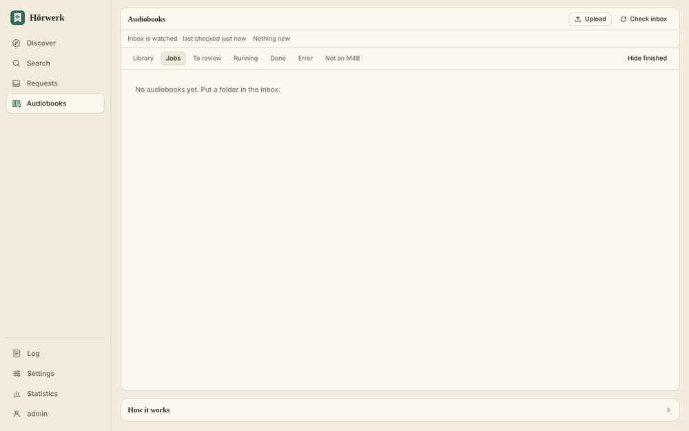
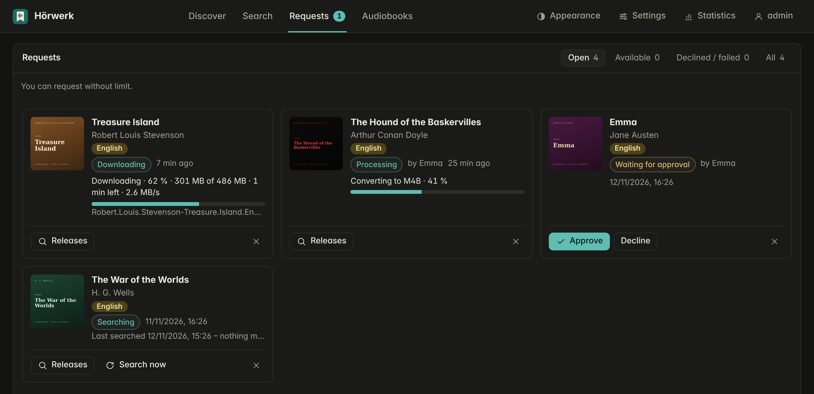
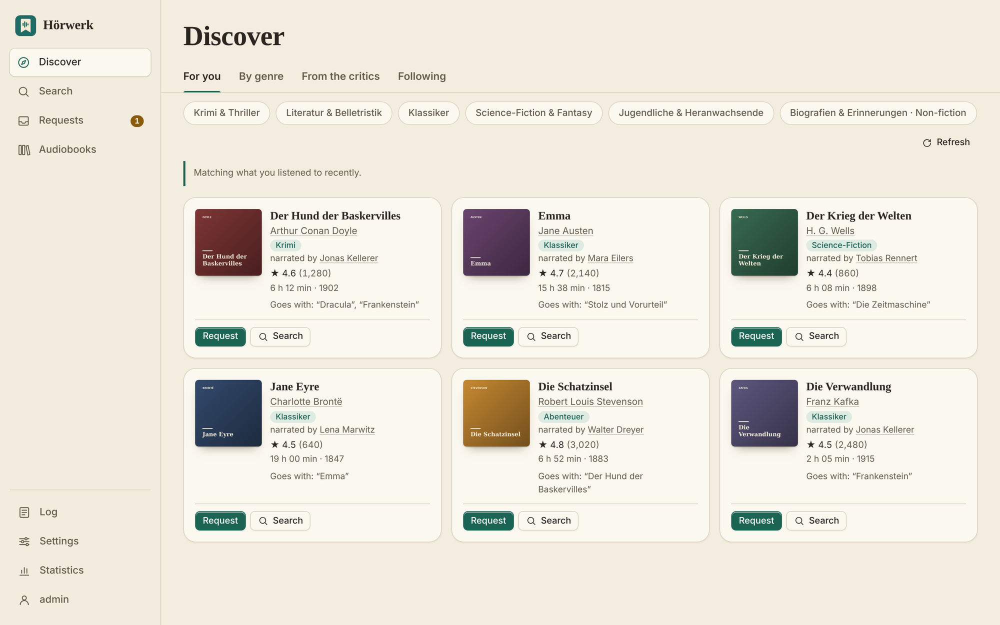
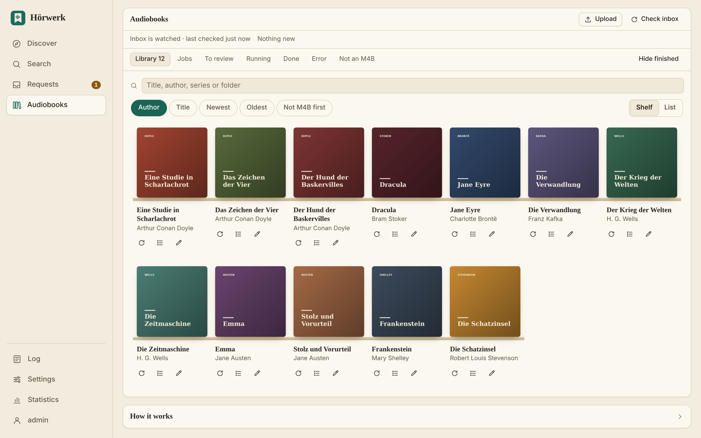

# Hörwerk

**Get, request and discover audiobooks – and end up with one clean, tagged M4B per book in your library.**

[](https://github.com/Larosen/hoerwerk/actions/workflows/docker.yml)
[](CHANGELOG.md)
[](LICENSE)

**English** · [Deutsch](README.de.md)



I built Hörwerk because my audiobook folder was a mess: CD rips split into `CD1`/`CD2`, MP3s named `Track 01`,
half the books missing covers, and the family asking me for new ones by message. Merging with one tool, tagging with
another and searching by hand took an evening per book. Hörwerk sits on the NAS next to Audiobookshelf or Plex and
does all of it in one go.

## What it does

- **Inbox → library, hands-off.** Drop a folder (MP3, M4A, FLAC, `CD1`/`CD2` …) and get **one M4B with chapters**,
  filed as `Author/Series/03 - Title`, with cover, narrator, series and description from Audible.
- **Requests like Overseerr.** Family accounts discover and request books; you approve, Hörwerk fetches them and
  shows download and conversion progress. **Follow** an author or narrator and every new book is requested by itself –
  or pick from all their books at once.
- **A search that understands audiobooks.** It judges every release before loading it: right book, right language,
  unabridged, and the *right recording* – not the single-narrator reading when you asked for the full cast.
- **Free audiobooks built in.** LibriVox (public domain) in English and German, one click into the inbox.
- **A tidy library.** Spots duplicates, converts old MP3 books, cleans chapter names, finds a better release for a
  book you already have – and never deletes the old copy without a verified new one.
- **Small and locked down.** One Rust program, its own minimal ffmpeg in a sandbox, two-factor login, signed images.

| Requests with live progress | Discover |
|---|---|
|  |  |



## Quick start

**Unraid:** *Docker → Add Container*, template
`https://raw.githubusercontent.com/Larosen/hoerwerk/main/unraid/hoerwerk.xml`, set the inbox and library folders,
open `http://<unraid-ip>:8080` and create the admin account.

**docker compose:**

```bash
curl -O https://raw.githubusercontent.com/Larosen/hoerwerk/main/docker-compose.yml
# set the two folder paths and PUID/PGID (see `id`), then:
docker compose up -d
```

Image: `ghcr.io/larosen/hoerwerk:latest` (or a fixed version such as `:7.17.1`) – amd64, rebuilt every week for
security updates, signed with cosign.

## What it is not

- **No player.** Hörwerk fills the library; you listen with Audiobookshelf, Plex or any app that plays M4B.
- **No source of books.** It works with *your* files, *your* SABnzbd and *your* indexers. The only built-in source
  is LibriVox. It removes no copy protection.
- **amd64 only** for now; arm64 is on the [roadmap](docs/ROADMAP.md).

## Documentation

| | |
|---|---|
| [Audiobooks](docs/en/guide.md) | inbox, upload, matching, duplicates, chapters, editions, Audiobookshelf and Plex |
| [Downloads, discover, requests](docs/en/downloads.md) | SABnzbd and indexers, LibriVox, suggestions, family requests |
| [Configuration](docs/en/configuration.md) | accounts, access from outside, notifications, variables, backup |
| [Security](SECURITY.md) | what Hörwerk protects against and how that is tested |
| [Changelog](CHANGELOG.md) · [Roadmap](docs/ROADMAP.md) · [Development](docs/en/development.md) | |

> Hörwerk organises audio you are entitled to use – your own purchases, your own recordings or public-domain works.
> It ships no media and is not affiliated with Audible, Amazon, Apple, LibriVox or any other service named here.
> The books in the screenshots are public-domain classics with made-up covers.

## License

[MIT](LICENSE). The Docker image also contains FFmpeg, built from its official source without GPL parts and therefore
under the [LGPL 2.1](https://www.ffmpeg.org/legal.html); the build script is [docker/build-ffmpeg.sh](docker/build-ffmpeg.sh).
Inspired by [auto-m4b](https://github.com/seanap/auto-m4b) and [beets-audible](https://github.com/Neurrone/beets-audible);
chapter data via [Audnexus](https://github.com/laxamentumtech/audnexus).
