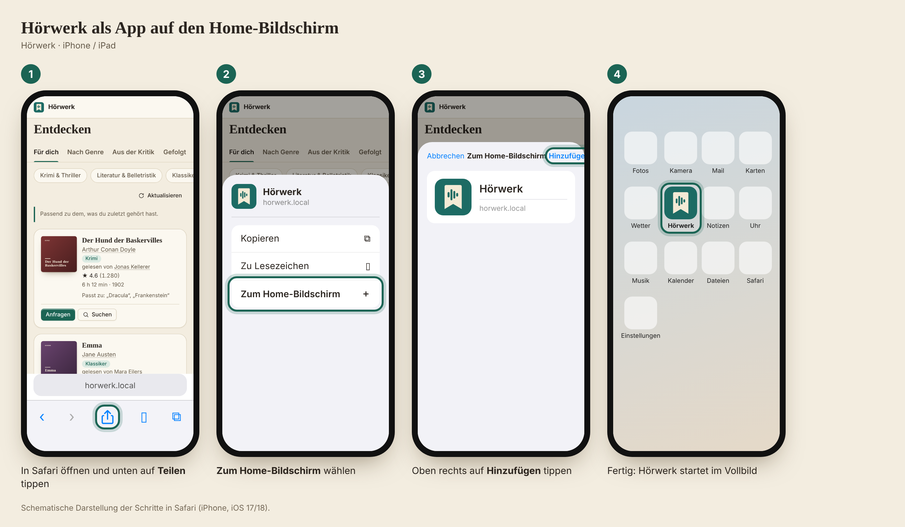

# Hörwerk als App auf dem iPhone

[← README](../../README.md) · [English](../en/iphone-app.md) · **Deutsch**

Hörwerk lässt sich auf den Home-Bildschirm von iPhone und iPad legen. Es startet dann im Vollbild, ohne Adressleiste und
mit eigenem Symbol – wie eine App, aber ohne den App Store. Dahinter steckt dieselbe Seite wie im Browser; ein Update ist
nie nötig.

*Schematische Darstellung der Schritte in Safari (iPhone, iOS 17/18). Die Oberfläche von Hörwerk ist original, die Menüs von
iOS sind nachgezeichnet.*

## So geht's

1. **Hörwerk in Safari öffnen** – mit der Adresse, unter der du es sonst im Browser nutzt (nicht in einer anderen App).
2. Unten auf **Teilen** tippen: das Quadrat mit dem Pfeil nach oben.
3. Nach unten wischen und **Zum Home-Bildschirm** wählen.
4. Oben rechts auf **Hinzufügen** tippen.

Danach liegt das Hörwerk-Symbol auf dem Home-Bildschirm. In der App selbst steht die Anleitung auch unter
**Konto → Als App auf dem iPhone**; läuft Hörwerk schon als App, steht dort stattdessen „Hörwerk läuft gerade als App.“

## Gut zu wissen

- **Anmelden:** Die Anmeldung bleibt bestehen, solange „Angemeldet bleiben (30 Tage)“ gewählt war. Abmelden geht über
  **Mehr → Abmelden**.
- **Farbwelt:** Hell, Dunkel oder OLED (echtes Schwarz) stellst du unter **Konto → Anzeige** ein – für alle Geräte oder nur
  für das iPhone. OLED spart auf dem iPhone Akku.
- **Von unterwegs:** Die Adresse muss vom Handy aus erreichbar sein (VPN oder Reverse-Proxy mit HTTPS, siehe
  [Konfiguration → Konten und Zugriff von außen](configuration.md#konten-und-zugriff-von-außen)).
- **Zum Hören** brauchst du weiterhin eine Hörbuch-App wie Audiobookshelf oder Plex – Hörwerk ist kein Player. Beide lassen sich
  auf dieselbe Weise auf den Home-Bildschirm legen.
- **Entfernen:** Symbol gedrückt halten → **App entfernen**.
- **Android und Chrome:** Menü ⋮ → **App installieren** (oder **Zum Startbildschirm hinzufügen**).
