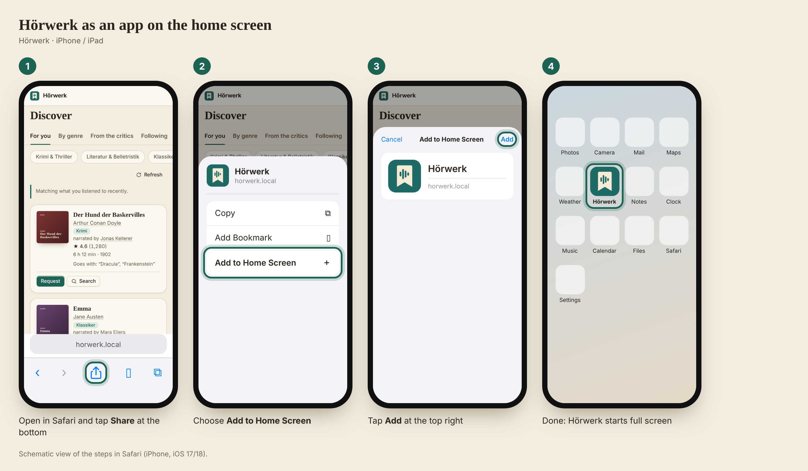

# Hörwerk as an app on the iPhone

[← README](../../README.md) · **English** · [Deutsch](../de/iphone-app.md)

Hörwerk can be put on the home screen of an iPhone or iPad. It then starts full screen, without an address bar and with
its own icon – like an app, but without the App Store. It is the same page as in the browser, so there is never an update
to install.

*Schematic view of the steps in Safari (iPhone, iOS 17/18). Hörwerk's interface is the real one, the iOS menus are redrawn.*

## How to

1. **Open Hörwerk in Safari** – at the address you normally use in the browser (not inside another app).
2. Tap **Share** at the bottom: the square with the arrow pointing up.
3. Scroll down and choose **Add to Home Screen**.
4. Tap **Add** at the top right.

After that the Hörwerk icon sits on the home screen. The same steps are shown in the app under **Account → As an app on the
iPhone**; when Hörwerk already runs as an app it says “Hörwerk is running as an app.” there instead.

## Good to know

- **Signing in:** the sign-in stays as long as “Stay signed in (30 days)” was ticked. Sign out via **More → Sign out**.
- **Colour scheme:** light, dark or OLED (true black) is set under **Account → Display** – for all devices or for the
  iPhone only. OLED saves battery on the iPhone.
- **On the go:** the address must be reachable from the phone (VPN, or a reverse proxy with HTTPS, see
  [Configuration → Accounts and access from outside](configuration.md#accounts-and-access-from-outside)).
- **To listen** you still need an audiobook app such as Audiobookshelf or Plex – Hörwerk is not a player. Both can be put on the
  home screen the same way.
- **Removing:** press and hold the icon → **Remove App**.
- **Android and Chrome:** menu ⋮ → **Install app** (or **Add to Home screen**).
